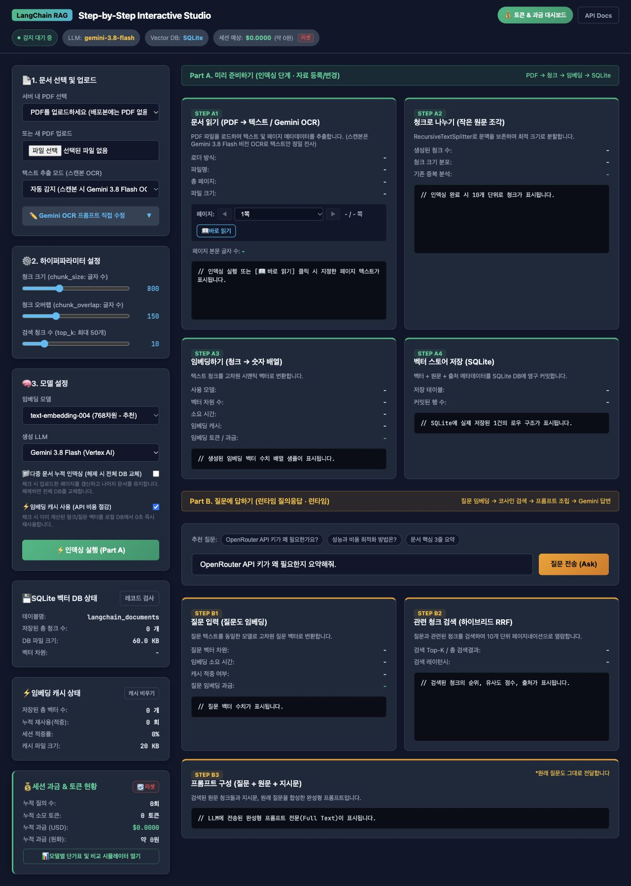

# RAG Step-by-Step Student Studio 1.2.0

[](https://github.com/venture21/RAG-tutorial/actions/workflows/offline-checks.yml)

PDF 읽기 → 청크 분할 → 임베딩 저장 → 근거 검색 → 답변을 단계별로 확인하는 PC용 학습 서비스입니다.
왼쪽 설정 패널 320px, 오른쪽 단계 카드 2열과 최소 작업 폭 1280px를 유지합니다.

**이 ZIP에는 PDF, 실제 .env, 키·인증 파일, DB·캐시·로그·업로드 자료·가상환경이 없습니다.**
본인 PDF와 본인 Google Cloud 프로젝트·ADC를 사용하세요.

GitHub: [venture21/RAG-tutorial](https://github.com/venture21/RAG-tutorial).
Code → Download ZIP 또는 `git clone https://github.com/venture21/RAG-tutorial.git`으로 받은 뒤
아래 설치 안내를 따릅니다. GitHub Pages로 서버를 실행하는 프로젝트는 아닙니다.
[GitHub 배포 안내](docs/GITHUB.txt)도 확인하세요.

## 설치·실행 안내

- [맥북 / macOS](docs/INSTALL_MACOS.txt)
- [Linux](docs/INSTALL_LINUX.txt)
- [Windows PowerShell](docs/INSTALL_WINDOWS.txt)

Python 3.11을 권장합니다. 각 OS에서 가상환경을 새로 생성하고 `requirements.txt`를 해시 검증 옵션으로 설치합니다.
`uv.lock`과 `pyproject.toml`도 포함되어 있습니다. `.env.example`을 `.env`로 복사하고 프로젝트 ID를 바꾸세요.
가상환경의 Python으로 `check_setup.py`, `app_rag.py`를 실행한 뒤 http://127.0.0.1:8000 에 접속합니다.

화면과 일반 PDF 바로 읽기는 ADC 없이 확인할 수 있습니다. 실제 인덱싱에는 클라우드 임베딩이 필요하고,
자동 OCR·클라우드 답변에도 비용이 발생할 수 있습니다. Ollama 선택 시 답변 생성만 로컬입니다.
데이터는 기본 `data/`에 생성되며 `RAG_DATA_DIR`로 바꿀 수 있습니다. 상위 폴더의 `.env`는 읽지 않습니다.
로컬 실습용 서버이므로 인터넷에 공개하지 않습니다. 비용 대시보드는 실습용 예시·추정치입니다.

## app_rag.py 실행과 웹 화면

웹 서비스의 실행 파일은 **`app_rag.py`**입니다. 위 OS별 안내에 따라 의존성 설치와 환경 설정을 마친 뒤,
터미널의 현재 위치를 `app_rag.py`가 있는 `RAG-tutorial` 폴더로 옮겨 실행합니다.

**macOS / Linux**

```bash
.venv/bin/python check_setup.py
.venv/bin/python app_rag.py
```

**Windows PowerShell**

```powershell
.\.venv\Scripts\python.exe check_setup.py
.\.venv\Scripts\python.exe app_rag.py
```

터미널에 `Uvicorn running on http://127.0.0.1:8000`이 표시되면 서버가 실행된 상태입니다.
터미널을 열어 둔 채 브라우저에서 **[http://127.0.0.1:8000](http://127.0.0.1:8000)**에 접속하세요.
서버를 종료할 때는 실행 중인 터미널에서 `Ctrl+C`를 누릅니다.
`check_setup.py`에서 ADC 미설정을 안내해도 초기 화면은 확인할 수 있으며, 실제 클라우드 실습 전에는 OS 안내에 따라 ADC를 준비합니다.

### PC 실행 화면

아래는 배포본을 실행한 **PDF 업로드·인덱싱 전 초기 화면**입니다. 이미지를 클릭하면 원본 크기로 볼 수 있습니다.
왼쪽 설정 패널과 오른쪽 2열 단계 카드를 유지하며, 창이 1280px보다 좁으면 가로 스크롤로 확인합니다.
`감지 대기 중`, 저장된 청크 `0개`, 예상 비용 `$0.0000`은 아직 문서 처리와 모델 호출을 하지 않은 상태입니다.

[](docs/images/app-rag-pc.jpg)

| 화면 영역 | 확인할 내용 |
| --- | --- |
| 상단 상태 표시 | 선택한 LLM, SQLite 사용 여부, 세션 예상 비용, API Docs |
| 왼쪽 설정 패널 | PDF 업로드, 텍스트/OCR 방식, 청크 크기·오버랩·Top-K, 임베딩·생성 모델 선택 |
| Part A: 미리 준비하기 | A1 문서 읽기 → A2 청크 분할 → A3 임베딩 → A4 SQLite 저장 |
| Part B: 질문에 답하기 | 질문 입력 → 질문 임베딩 → 관련 청크 검색 → 프롬프트 확인 → 생성 답변 확인 |
| DB·캐시·비용 도구 | 레코드 검사, 캐시 재사용 상태, 토큰 및 실습용 예상 비용 확인 |

### 처음 사용하는 순서

1. **PDF 업로드**: 왼쪽 `파일 선택`에서 본인 PDF를 올립니다. 배포본에는 PDF가 포함되지 않습니다.
2. **문서 확인**: 일반 텍스트 PDF라면 추출 모드를 `일반 디지털 텍스트 추출 (PyPDF)`로 고르고 `바로 읽기`로 내용을 확인합니다. 자동 감지·강제 OCR은 필요한 경우 클라우드 OCR을 호출합니다.
3. **인덱싱**: 청크·모델 설정을 확인하고 `인덱싱 실행 (Part A)`을 누릅니다. A1~A4에서 추출 텍스트, 청크, 벡터와 저장 결과를 차례로 확인합니다. 이 단계의 임베딩에는 본인 프로젝트와 ADC가 필요합니다.
4. **질문하기**: Part B의 예시 질문을 본인 문서에 맞는 질문으로 바꾸고 `질문 전송 (Ask)`을 누릅니다. 저장할 때와 같은 임베딩 모델을 사용해 검색 근거·프롬프트·답변을 살펴봅니다.
5. **결과 점검**: `레코드 검사`로 저장 내용을 확인하고 `토큰 & 과금 대시보드`에서 사용량을 봅니다. 표시 비용은 실습용 추정치이며 실제 청구액과 다를 수 있습니다.

문서를 누적할 때는 `다중 문서 누적 인덱싱`을 선택하세요. 선택하지 않으면 전체 인덱스를 교체합니다.
`ModuleNotFoundError`가 나오면 OS별 설치 안내의 가상환경과 의존성 설치를, ADC 오류가 나오면 본인 프로젝트·로그인 설정을 확인합니다.

## 문서 갱신

다중 문서 누적 인덱싱을 선택하면 이번 업로드에 해당하는 페이지만 교체하고 없는 페이지는 유지합니다.
같은 파일명은 같은 논리 문서로 취급합니다. 별개 문서는 이름을 다르게 사용하세요.
페이지는 업로드 PDF의 물리적 1쪽부터 세므로 중간 발췌본의 원래 쪽수를 자동 추측하지 않습니다.
누적 옵션을 해제하면 전체 인덱스를 교체합니다. 실패하면 기존 인덱스는 유지됩니다.
임베딩 모델을 바꿀 때는 전체 재인덱싱하고 질문에도 저장 모델과 같은 모델을 선택합니다.

## CLI·검증

아래 python을 OS 안내서의 가상환경 Python 경로로 바꾸어 실행합니다.

```text
python rag_step_by_step.py --pdf "본인자료.pdf" --auth adc --ocr-mode pypdf
python rag_step_by_step.py --skip-indexing --interactive
python run_offline_checks.py
```

CLI도 ADC 전용이며 웹과 같은 로직을 사용합니다. 누적 갱신이 기본이고 `--reindex`가 전체 교체입니다.
`--question` 또는 `--interactive`를 지정해야 답변을 생성합니다. 오프라인 검사는 외부 호출 없이 임시 합성 자료만 사용합니다.

## 배포 범위와 검증

웹·CLI 소스, PC UI와 공개용 실행 화면, 의존성 잠금 파일, 환경 예시, 운영체제별 안내, 오프라인 테스트를 포함합니다.
기존 노트북, Weaviate/Docker 실습, 개인 스크린샷, 평가 데이터, PDF 가이드 생성물은 이 ZIP 범위에서 제외했습니다.
`ref_code/`에는 Gemini Flash-Lite·Claude·DeepSeek·Gemma 단독 채팅 참고 예제 4개를 포함합니다.
사용 방법은 [참고 코드 안내](ref_code/README.txt)를 확인하세요. 본인 ADC로 호출하며 실제 대화에는 비용이 발생할 수 있습니다.
수정 내역·검증 범위는 [RELEASE_NOTES.txt](RELEASE_NOTES.txt)를 확인하세요.

macOS Python 3.11 새 가상환경에서 검증했고, GitHub Actions는 macOS·Linux·Windows에서 설치·오프라인 검사 38개·패키징을 수행합니다.
실제 사용자 PC에서의 GUI·ADC 설정과 실제 클라우드 호출은 별도 확인이 필요합니다.
`python build_student_zip.py`는 허용 목록만 ZIP으로 묶고 금지 파일과 비밀정보 패턴을 검사합니다.
ZIP의 `MANIFEST.json`과 옆 `.sha256` 파일로 전달 무결성을 확인할 수 있습니다.

공식 참고: [Cloud CLI 설치](https://cloud.google.com/sdk/docs/install),
[ADC 준비](https://docs.cloud.google.com/docs/authentication/provide-credentials-adc),
[uv 잠금 파일](https://docs.astral.sh/uv/concepts/projects/sync/).
